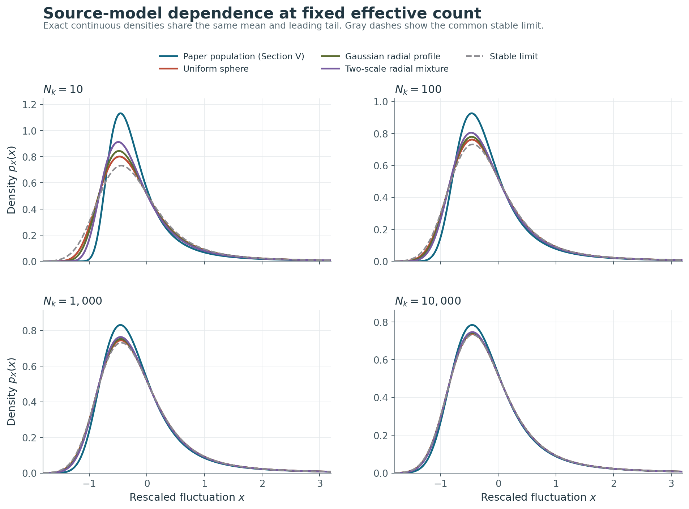

# Finite-source PTA background distributions

Analytic derivations, reproducible Python calculations, and figures extending
the large-effective-count probability distribution in Yacine Ali-Haïmoud,
[*A practical theorem on gravitational-wave background statistics*](https://arxiv.org/abs/2604.19701v1).

**Start with the [compiled derivation](paper/finite_N_PTA.pdf)** or its
[LaTeX source](paper/finite_N_PTA.tex). The calculations use the paper's
normalization of the effective source count `N = N_k`.

## Main result

Write `Y = h_c,k^2 / mean(h_c,k^2)` and `X = N^(1/3) (Y - 1)`.
The universal leading density of `X` is the reflected map-Airy distribution.
For the paper's explicit Section V population, the first shape correction is
of order **`N^(-1/3) log N`**. The full central expansion through relative
`1/N` includes the intermediate fractional orders and all products from
exponentiating the characteristic function.

The source models below share the same normalized mean and leading
bright-source tail. Their finite-count distributions differ because the
corrections depend on additional source-population information.



## Source models

All four models have source intensity
`rho(u) = u^(-5/2) F(u) / (4 sqrt(pi))`, with
`integral u rho(u) du = 1` and `F(u) -> 1` at large `u`.

| Code key | Source-shape function `F(u)` | Interpretation |
|---|---|---|
| `paper` | `(1 + 1/sqrt(4*pi*u))^(-2)` | Section V of the reference, with its narrow-band and inclination-averaged assumptions |
| `sphere` | `1` for `u >= 1/(4*pi)`, otherwise `0` | Identical-luminosity sources at uniform density inside a Euclidean sphere |
| `gaussian` | `exp(-1/(16*u))` | Identical-luminosity sources with a Gaussian radial density profile |
| `mixture` | `exp(-1/(64*u))/3 + 2*exp(-1/(4*u))/3` | Two radial Gaussian profiles with local-density fractions `1/3` and `2/3` and radii `2R` and `R/2` |

The three alternatives are **controlled illustrative source populations**, not
fits to a measured or simulated SMBHB mass/redshift distribution. “Gaussian”
describes the source profile; all four background distributions have an
infinite variance and the same heavy-tailed stable limit.

## Figures and numerical data

The main comparisons use `N_k = 10, 100, 1000, 10000`.
Every figure is supplied as a vector PDF and a PNG preview.

| Figure | What it shows |
|---|---|
| [Paper-model corrections](figures/paper_convergence.pdf) | Exact density, stable limit, and all three successive correction orders |
| [Source-model comparison](figures/source_models.pdf) | Four exact densities at fixed mean and effective count |
| [Physical distributions](figures/physical_distributions.pdf) | Narrowing of the density of normalized strain squared `Y` as `N_k` grows |
| [Convergence errors](figures/convergence_errors.pdf) | Maximum absolute error on 101 central grid points, for 13 counts from `10` to `100000` |
| [Source distributions](figures/source_flux_models.pdf) | The four functions `F(u)` and contributions to the mean per logarithmic source-flux interval |

The deterministic outputs in [`data/`](data/) include the density curves,
convergence errors, and exact runtime/grid settings. The plotted maximum
errors are sampled on `-1.5 <= x <= 2`; they are not global relative errors.

For example, at `N_k=1000` the sampled maximum absolute density errors are:

| Model | Stable limit | Through relative `1/N_k` |
|---|---:|---:|
| Paper population | 0.100593 | 0.00188304 |
| Uniform sphere | 0.0143083 | 0.00000179092 |
| Gaussian radial profile | 0.0224515 | 0.00000644575 |
| Two-scale radial mixture | 0.0340146 | 0.0000336781 |

## Reproduce

Python 3.10 or newer is required. Install the numerical dependencies:

```bash
python -m venv .venv
source .venv/bin/activate
python -m pip install -r requirements.txt
```

Regenerate all plots and CSV tables:

```bash
python scripts/make_figures.py
```

The default Fourier grid uses `dt=0.02` and `tmax=160`. A finer grid can be
requested explicitly:

```bash
python scripts/make_figures.py --dt 0.01 --tmax 240
```

Compile the document with a working TeX installation containing `latexmk`,
PDFLaTeX, and BibTeX:

```bash
make paper
```

Run the independent numerical checks:

```bash
python -m unittest discover -s tests -v
```

`make all` regenerates the figures and compiles the document. The compiled
PDF and figures are already included, so TeX is only needed to rebuild them.

## Use the numerical module

```python
import sys
import numpy as np
sys.path.insert(0, "src")
from pta_distribution import density_curves, density_quad

x = np.linspace(-1.5, 3, 300)
curves = density_curves(x, N=1000, model="paper")
exact = curves[None]     # Numerically inverted exact characteristic function
stable = curves[0]       # Reflected map-Airy limit
corrected = curves[3]    # All central terms through relative 1/N

# Independent adaptive quadrature at one point:
reference = density_quad(-1.0, N=1000, model="paper")
```

Orders `1`, `2`, and `3` retain terms through `N^(-1/3)`, `N^(-2/3)`, and
`N^(-1)` in the central rescaled density, including logarithms where present.
To obtain the density of `Y`, multiply by `N^(1/3)` and evaluate at
`x=N^(1/3)*(y-1)`. To obtain the density of dimensional strain squared,
divide once more by its mean.

## Numerical methods and scope

- Exact compensated exponents are evaluated using closed forms with
  convergent small-argument series to avoid cancellation.
- Grid inversion integrates the difference from the analytic stable density,
  reducing the common Fourier-endpoint error. An independent adaptive
  quadrature implementation provides reference values.
- Tests compare source integrals, characteristic functions, known density
  values, asymptotic orders, and Fourier-grid refinement. The smallest
  convergence errors in the plots were checked independently.
- Truncated expansions can become negative in the low-strain tail. The code
  retains those values rather than clipping or renormalizing them.
- The finite-total-count models include zero-source atoms at `Y=0` of mass
  `exp(-lambda*N)`, where `lambda=4*pi/3`, `8`, and `22`, respectively. The
  plotted/inverted densities are their continuous parts. At `N>=10`, these
  atoms are negligible; `zero_source_probability` returns their masses.
- Default numerical grids target `N>=10` and the plotted fluctuation range.
  Different regimes require checking the Fourier cutoff and grid spacing.

## Layout

- [`paper/`](paper/): LaTeX derivation, bibliography, and compiled PDF.
- [`src/pta_distribution.py`](src/pta_distribution.py): exact exponents, stable
  and corrected characteristic functions, and numerical inversion.
- [`scripts/make_figures.py`](scripts/make_figures.py): all publication figures
  and numerical tables.
- [`tests/test_distribution.py`](tests/test_distribution.py): independent
  mathematical and numerical verification.
- [`figures/`](figures/) and [`data/`](data/): reproducible generated outputs.
